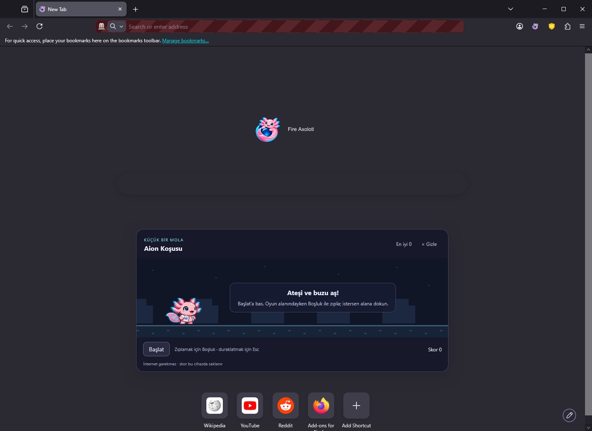
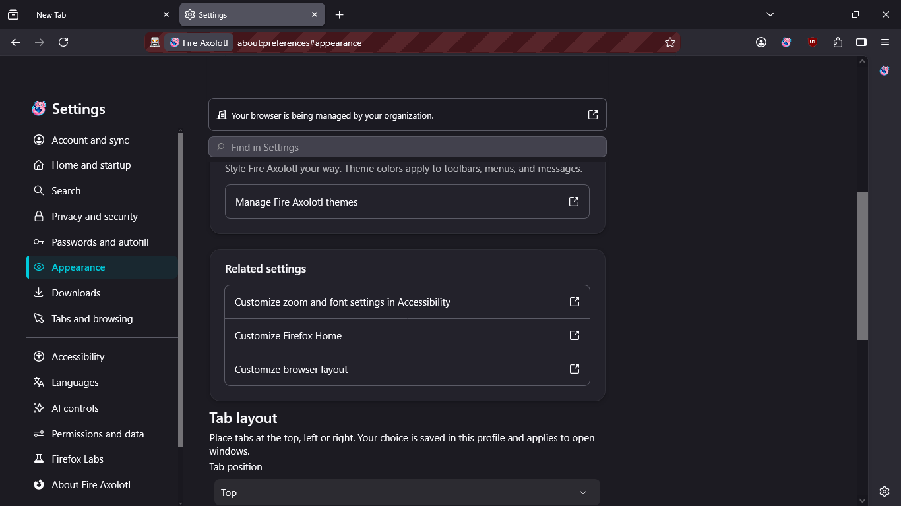
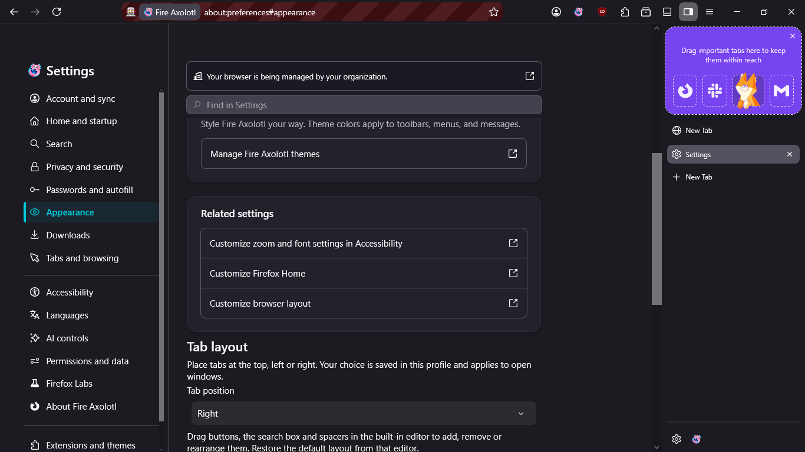
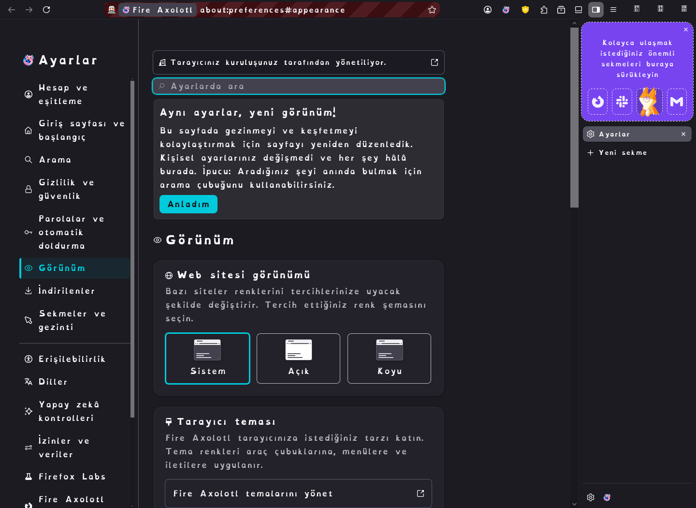
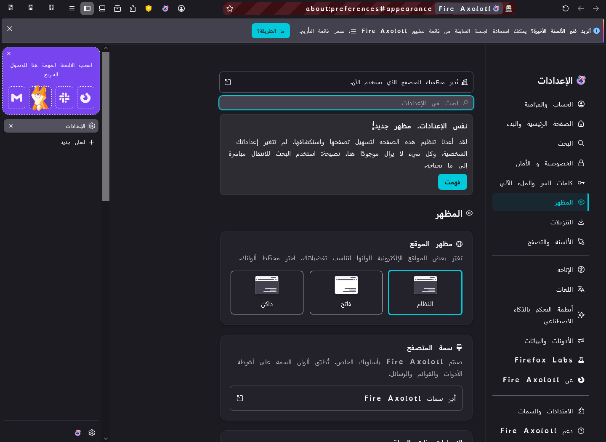
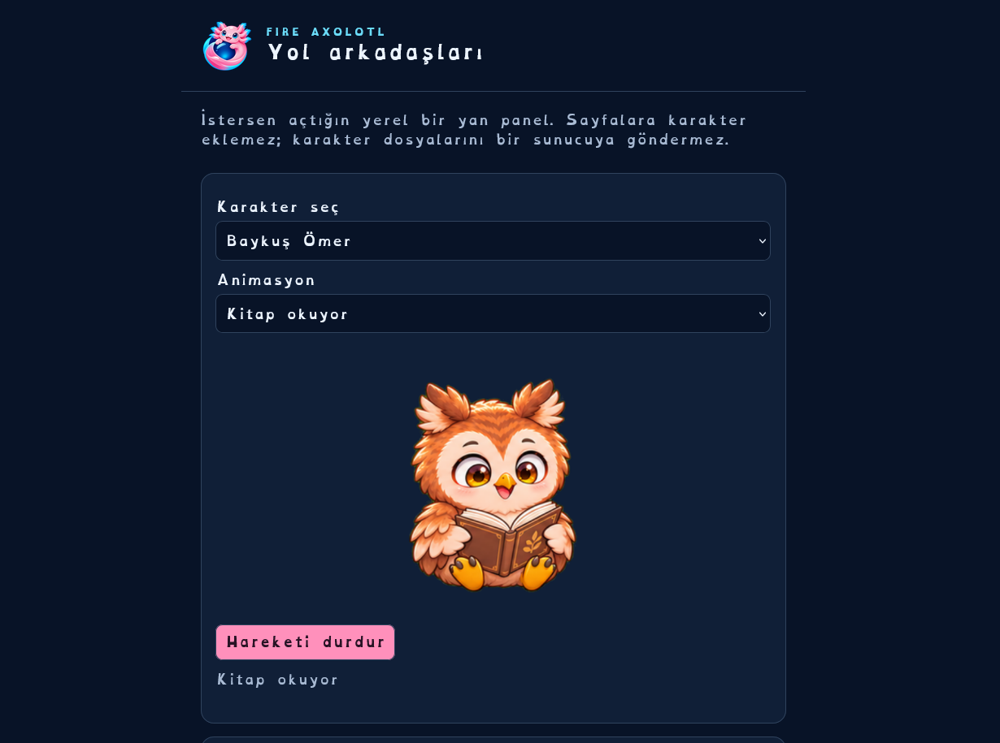

# Çalışan Fire Axolotl 153.7 arayüzü

2026-11-10. Bu görüntüler yayımlanmış Windows x64 Setup'ın kurduğu gerçek tarayıcıdan alındı: [başarılı kurulum/test/yayın](https://github.com/kaansavukduran/fire-axolotl/actions/runs/42849921106). Görüntülerin kaynak kanıt arşivinin SHA-256 özeti `2b967f0fd3cbeeccbf38d232c5f8cae9302aa4c4437388d0c2890ccbb2faf837`; ZIP CRC ve pikseller değiştirilmeden kopyalama doğrulandı. Bunlar taslak arayüz görselleri değildir.

Adres çubuğundaki çizgili işaret WebDriver otomasyonunun göstergesidir. Türkçe/Arapça örneklerindeki OpenDyslexic ve sağ sekmeler seçilmiş test ayarlarıdır; varsayılan font sistem fontu, sekmeler üsttedir. Yerel gizlilik ilkeleri nedeniyle Ayarlar'da görünen “kuruluşunuz tarafından yönetiliyor” bildirimi uzaktaki bir kuruluşu belirtmez.

## Yeni sekme ve Aion Koşusu

Oyun kullanıcı **Başlat** deyince çalışır. Boşluk/dokunma ile zıplama, buz/ateş animasyonları, sekme değiştirince duraklatma, yerel rekor ve gizleme bulunur. Bu erken başlangıç karesinde normal arama alanı henüz yükleniyor; arama motoru ve tıklama/klavye devri ayrıca doğrulandı.

## Sekme konumu ve normal ayarlar

Görünüm bölümündeki yerel kontrollerden üst, sol veya sağ konum seçilir. Normal araç çubuğu düzenleyicisi, bağımsız site renk tercihi ve tarayıcı fontu korunur.

## Diller ve erişilebilirlik

Ana tarayıcı 103 resmî Firefox masaüstü dilini içerir. Aion'un yeni metinleri Türkçe/İngilizcedir. Aşağıda normal Ayarlar seçicisiyle Türkçe ve Arapçaya geçiş sonrası gerçek pencereler görülür; Arapça sağdan sola yerleşim ve yeniden başlatma testini de geçti.

## Karakterler

Aion, kurt, kuzu ve baykuş kendi bütün gövdeli PNG karelerinden oynatılır. Panel isteğe bağlıdır; kendi PNG karakterini ekleme, duraklatma ve yerel yedekleme bulunur.

[İndir ve kullan](QUICK_START.md) · [Test sonuçları ve açık işler](VALIDATION.md). İmzalı otomatik güncelleme ve Authenticode henüz yoktur; bu sürüm geliştirici önizlemesidir.
