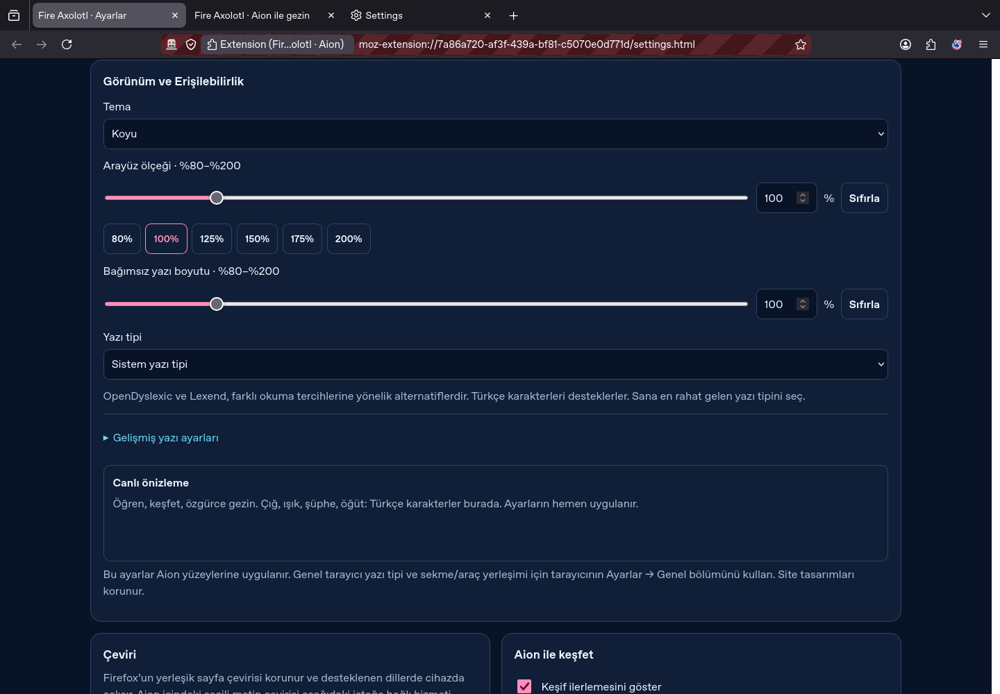
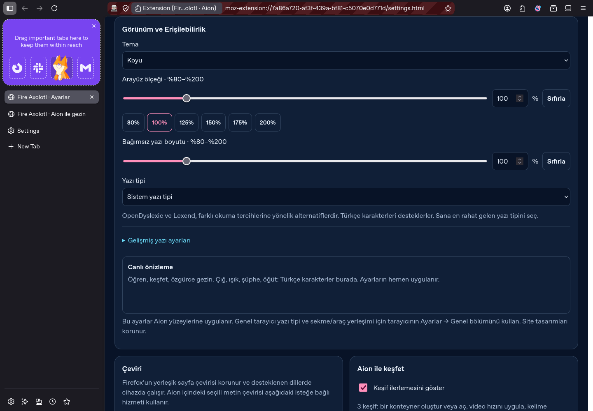
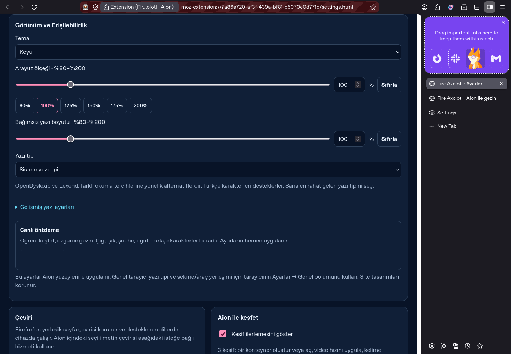
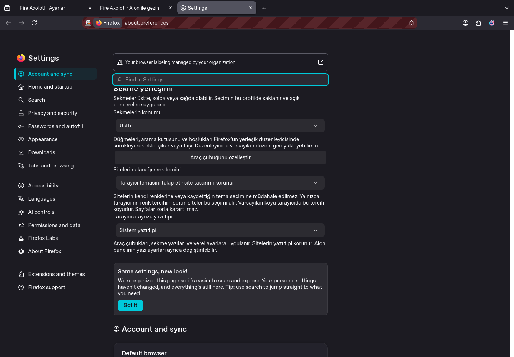
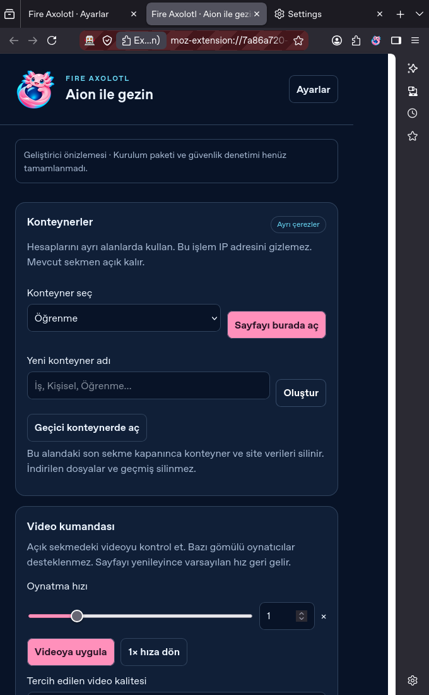

# Çalışan arayüz önizlemesi / Running interface preview

2026-11-09. Bu ekran görüntüleri, Firefox ESR 153.6.0esr üzerinde çalışan gerçek Aion modülünden ve test düzeneğine eklenen yerel ayar kontrollerinden alındı. Bağımsız Fire Axolotl motor derlemesi henüz tamamlanmadı ve kurulabilir tarayıcı sürümü yayımlanmadı. Firefox adlarının veya İngilizce yerleşik metinlerin göründüğü alanlar bu test ortamına aittir. Görseller, bağımsız tarayıcının hazır olduğunun kanıtı olarak sunulmaz.

These screenshots show the real Aion companion running on Firefox ESR 153.6.0esr and native source controls injected through the test harness. The independent Fire Axolotl build is unfinished and no browser installer has been released. Remaining Firefox names and English native strings belong to the test runtime.

## Üst sekmeler ve görünüm / Top tabs and appearance

Koyu tema, arayüz ölçeği, bağımsız yazı boyutu ve yazı tipi seçimi. / Dark theme, interface scale, independent text size and font choice.

## Solda sekmeler / Tabs on the left

## Sağda sekmeler / Tabs on the right

## Sekme ve site ayarları / Tab and website controls

Yerel kaynak kontrolü: sekme konumu, araç çubuğu düzenleyicisi, sitelere bildirilen renk tercihi ve tarayıcı arayüzü yazı tipi. / Native source control: tab placement, toolbar editor, website color preference and browser interface font.

## Aion paneli / Aion panel

Konteynerler ve video kumandası. Bu görüntüde panel ayrı sekmede açılmıştır. Konteyner adları yeni test profilinde oluşturulmuş örneklerdir. / Containers and video controls, with the panel opened in a separate tab. Container names are examples created in a fresh test profile.

Geliştirici modülünü denemek için [README adımlarını](../README.md#geliştirici-önizlemesini-dene--try-the-developer-companion) kullan. Bu, bağımsız tarayıcı kurulumunu veya imzalı güncellemeyi sağlamaz. / See the README for temporary companion installation; it does not install an independent browser or signed updater.
