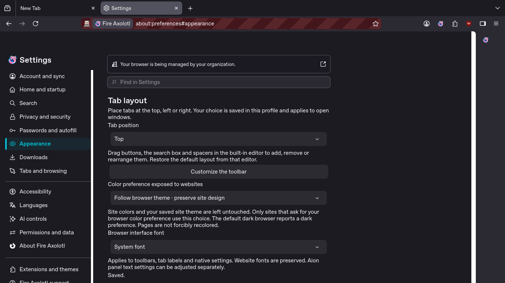
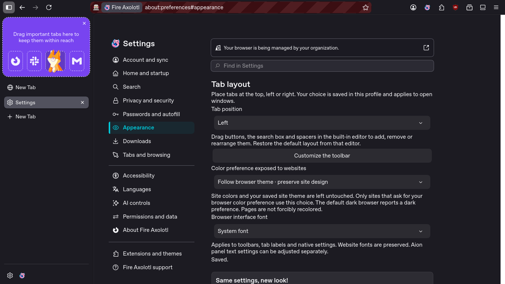
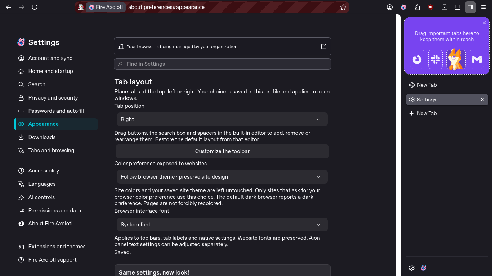
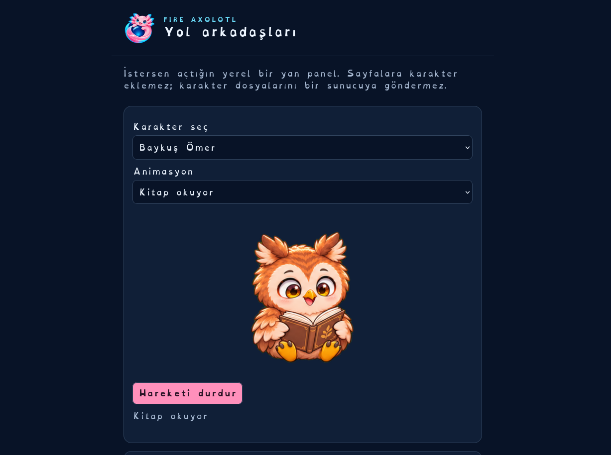
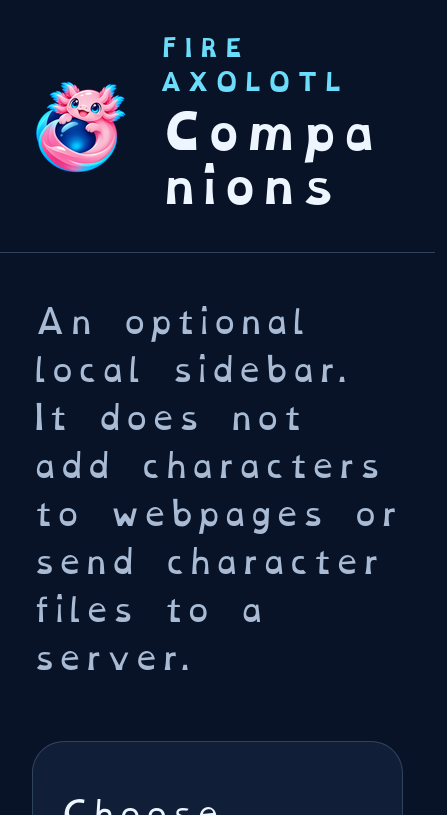
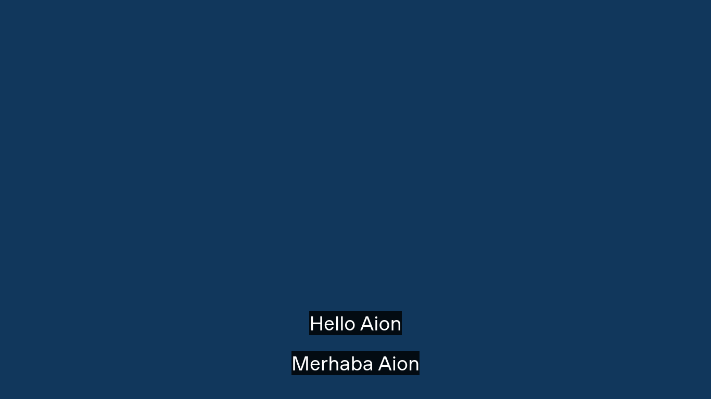

# Derlenen tarayıcının arayüzü / Compiled browser interface

2026-11-09. Bu yeni görüntüler Firefox ESR 153.6.0esr kaynaklarından derlenen **Fire Axolotl** çalıştırılarak çekildi. Aion ve uBlock Origin kullanıcı kurulumu olmadan yerleşik yükleniyor. Yerel ayar kontrolleri derlemeye dahildir; görüntüler için ürün kodu enjekte edilmedi.

These images come from the independently compiled Fire Axolotl, with packaged native controls and built-in modules, rather than a mock-up or temporary companion installation.

Bu hâlâ geliştirici önizlemesidir. Güvenli otomatik güncelleme, bütün diller, gerçek hesapla Sync ve diğer platform paketleri tamamlanmadı. Yerleşik metinler bu derlemede İngilizce; Aion Türkçe/İngilizce seçilebilir. Adres çubuğundaki çizgili işaret otomasyon oturumunun göstergesidir. Seçilmiş büyük yazı ve OpenDyslexic ürünün varsayılanı değildir.

Developer preview: signed updates, complete localization, real-account Sync and other platforms remain pending. The striped address field marks automation; enlarged text and OpenDyslexic in some images are selected test settings, not defaults.

## Varsayılan üst sekmeler / Default top tabs

Yeni profilde koyu tema ve üst sekmeler. Görünüm bölümünde sekme konumu, araç çubuğu düzenleyicisi, sitelere bildirilen renk tercihi ve tarayıcı fontu bulunur.

## İsteğe bağlı sol veya sağ sekmeler / Optional left or right tabs

Seçim tam yeniden başlatmada korunur. / The chosen layout survives a full browser restart.

## Karakterlerin çizilmiş animasyon kareleri / Whole-character animation frames

Aion, kuzu, kurt ve baykuş kendi resim dizilerinden oynatılır. Görüntü, karakter sayfasındaki kitap okuma karesidir. İsteğe bağlı yan panel, kendi PNG kare şeridini ekleme, duraklatma ve karakter yedeği de bulunur.

## Videonun kendi tam ekranında çift altyazı / Dual captions in native video fullscreen

Yerel test videosu ve altyazı dosyaları kullanıldı. Bu görüntü Netflix veya bütün oynatıcılarla uyumluluk iddiası değildir. / Original local video/subtitle fixtures; streaming-service compatibility remains separate.

Doğrulama ve kalan işler: [VALIDATION.md](VALIDATION.md), [FEATURES.md](FEATURES.md). Eski `preview-*` görselleri önceki upstream Firefox test düzeneğinin tarihsel kayıtlarıdır.
